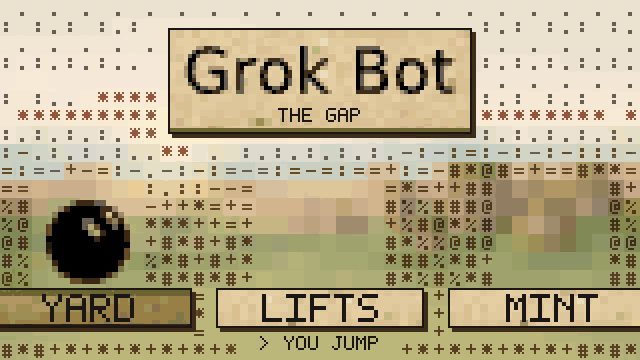
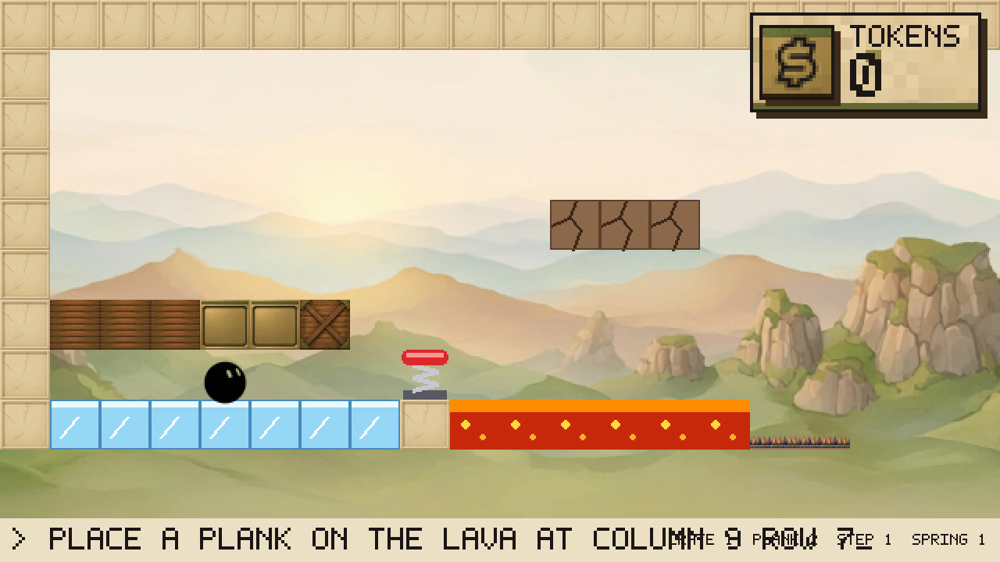
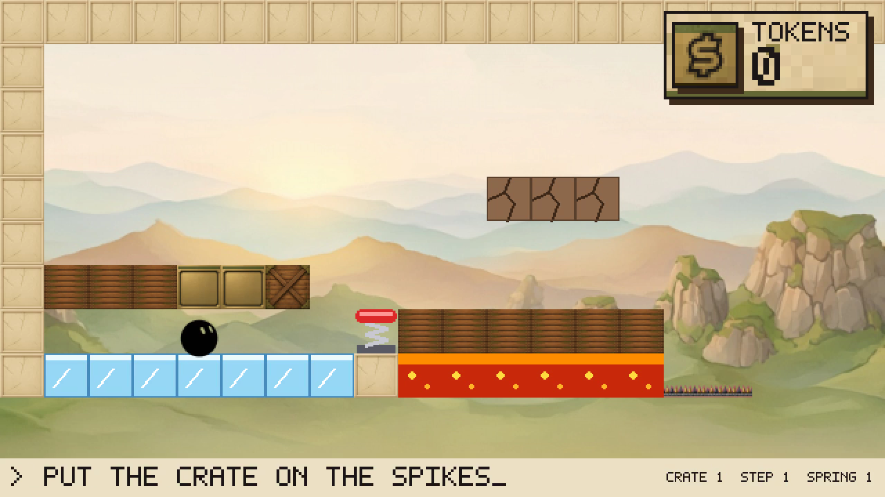
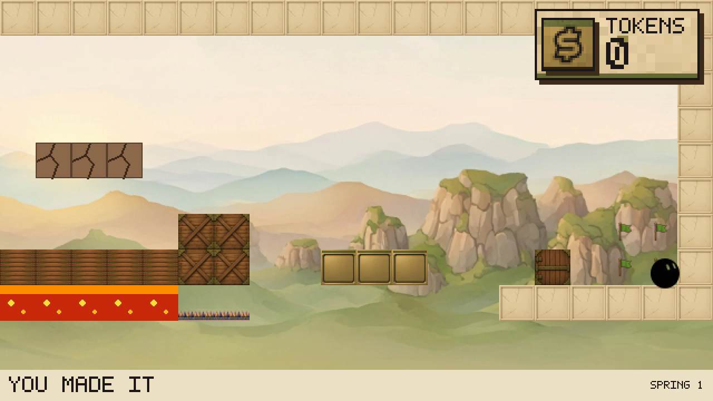
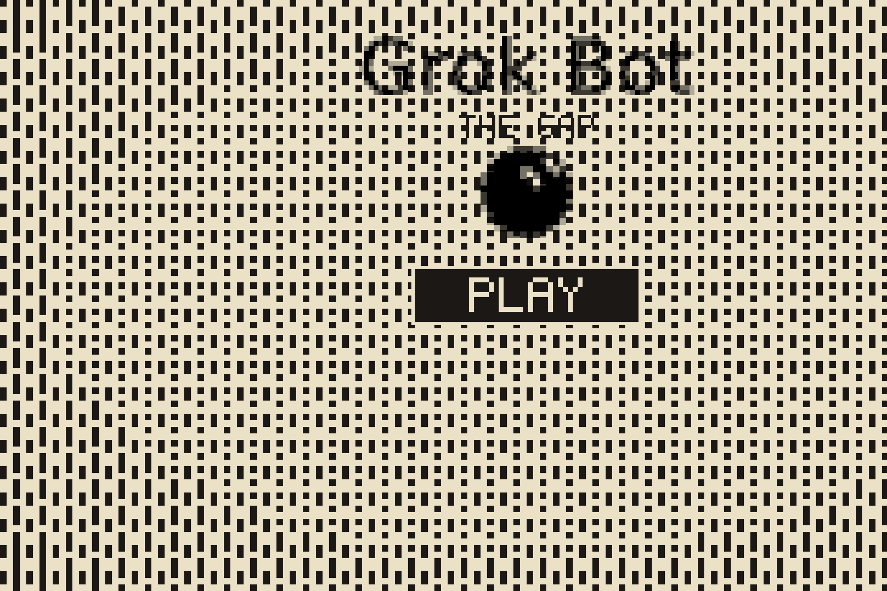
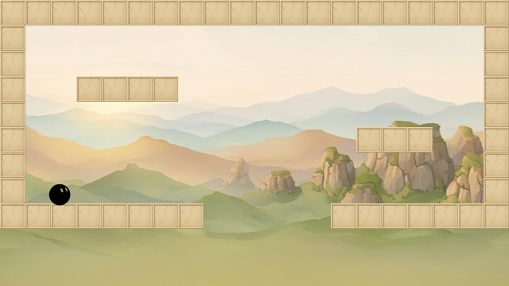
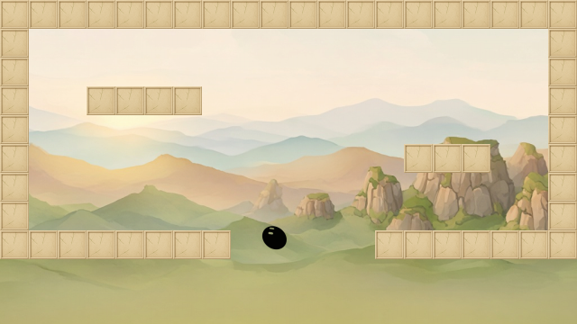

# Grok the Gap

*by Team Rosół*

**You jump. The AI rewires the map.**

A 2D pygame platformer where you and an in-game AI share one level. You cannot finish a stage alone: the layout is always a little wrong — a pit too wide, a door shut, a platform one tile too low. Type what you need in the game window, the AI edits real objects in the world, and you play through the new geometry.

Co-op here means **human + AI on the same map**, not online PvP.



## Why this exists

Most "AI in a game" is a chatterbot or a second shooter. We want the AI to be a **live level editor** that acts only when you ask, and only by moving things you can see. That forces a kind of play a static map can't give you:

- You still have to run and jump.
- You also have to decide *what* to change and *when*.
- The win is shared. If nobody prompts, the exit stays unreachable. If the AI teleports you, it's the wrong game.

## Demo

The YARD level, recorded from the desktop build with live Grok calls. Each line is typed into the in-game prompt box; the AI places a plank on the lava, a second plank, the crate on the spikes and the step in the gap. The ball bounces off the spring, crosses, and the game says **you made it**. Full video: [`docs/demo/walkthrough.mp4`](docs/demo/walkthrough.mp4).

| Prompt typed in game | Two planks bridge the lava | Exit reached |
| --- | --- | --- |
|  |  |  |

[](https://youtu.be/cwMLeEJvMvo)

## How a level plays

1. You explore and hit a **soft lock**: a gap you can't jump, a gate you can't open, a missing path.
2. You prompt in natural language inside the game: *"raise the left platform"*, *"bridge the pit"*, *"open the gate"*.
3. The AI applies the smallest safe edit: move, place, remove, or toggle a named object.
4. The change is visible (highlight + short confirmation), collision updates, and you use the new layout.
5. Repeat until the exit. A clear requires **player movement and at least one successful AI edit**.

```
#  ground     ~  pit     P  you     E  exit

Before                          After "bridge the pit"
##########################      ##########################
P          ~~~~~~       E       P     ##########        E
##########################      ##########################
           too wide                        you jump it
```

## Quick start

```bash
pip install -r requirements.txt
python -m tilebase.play
```

The window opens on the title screen; Enter, Space, or clicking **Play** starts. Escape quits.

### Controls

| Action | Keyboard | Gamepad |
| --- | --- | --- |
| Move | Arrows / WASD | Stick / D-pad |
| Jump (hold for higher) | Space, C, Z | A |
| Dash (8 directions) | X, Shift | B, X |
| Respawn | R | |
| Mute music | M | |
| Debug readout | F1 | |

Jumping, wall jumping, dashing, landing, hitting a ceiling, and falling out of the map each play a sound; a short tune loops from the title screen on.

### Screenshots







## How it's built

Hackathon time is short, so the stack stays small and the AI stays bounded.

- **Engine.** pygame, side-view 2D. The world is tiles plus a handful of **named editable objects** (platforms, doors, bridges, blocks, switches). Physics stays ordinary; the interesting part is mutation. The view is 640×360, scaled to the window.
- **AI pipeline.** Prompt → structured edit command → apply to allowed objects → re-collide → show what changed. The model doesn't "win the level": it proposes an edit inside a sandbox of allowed object types, actions, and bounds, prefers the smallest change that unblocks you, and refuses edits that delete the exit, bury the player, or make the map unplayable.
- **Prompt UI.** Chat lives in the game window. No separate tool, no second screen. Speech input (`tilebase/speech.py`) is available on desktop.
- **Feedback.** If the AI moved a platform, you see it move. The jury should never have to guess whether the model did anything.
- **Levels.** Each stage teaches **one AI verb** first (move, open, place a bridge, remove). Later stages sequence prompts or add timing. Every level follows [`level-design-template.md`](level-design-template.md): a soft lock, a demo prompt, and a known fail set.

### Code map

| Module | Role |
| --- | --- |
| `tilebase/player.py` | Pure controller: run/accel, variable jump with apex hang, coyote time, jump buffering, wall slide/jump, one dash charge refilled on landing. The ball forgives corners: slips around ceiling corners, pops over low lips, rolls off ledges it barely stands on. All numbers live in `player.Tuning`. |
| `tilebase/blob.py` | Hero animation: squash and stretch, roll angle that follows distance and rocks back eyes-up on stop, dust puffs. |
| `tilebase/art.py` | Paints the world with Nikolas's art from `assets/`: the Grok Bot ball (idle, jump, climb; turns blue when the dash is spent), tiles from `assets/tiles/`, parallax `assets/bg.png`. |
| `tilebase` (scaffold) | `load_map` reads a character grid, `put_cell` returns a grid with one cell replaced, `plan_move` picks a body's delta, `move_body` applies it and stops on blocking tiles. |

The bare tile scaffold still runs on its own with `python -m tilebase`: a fullscreen 320×180 integer-scaled view where arrow keys slide a rectangle (no jumping).

## Play in the browser

```bash
pip install pygbag
scripts/build_web.sh --serve   # then open http://localhost:8000
```

pygbag ships the Python sources with a WebAssembly CPython and pygame-ce. `main.py` is the browser entry point; the game awaits `asyncio.sleep(0)` each frame so the page can draw. Only `main.py`, `tilebase/` and `assets/` are bundled, so `.env.local` never goes public. Without `--serve`, the script writes a static site to `build/grok-the-gap/build/web`.

The web build can lag behind the desktop game and has no speech input — rebuild before a demo.
